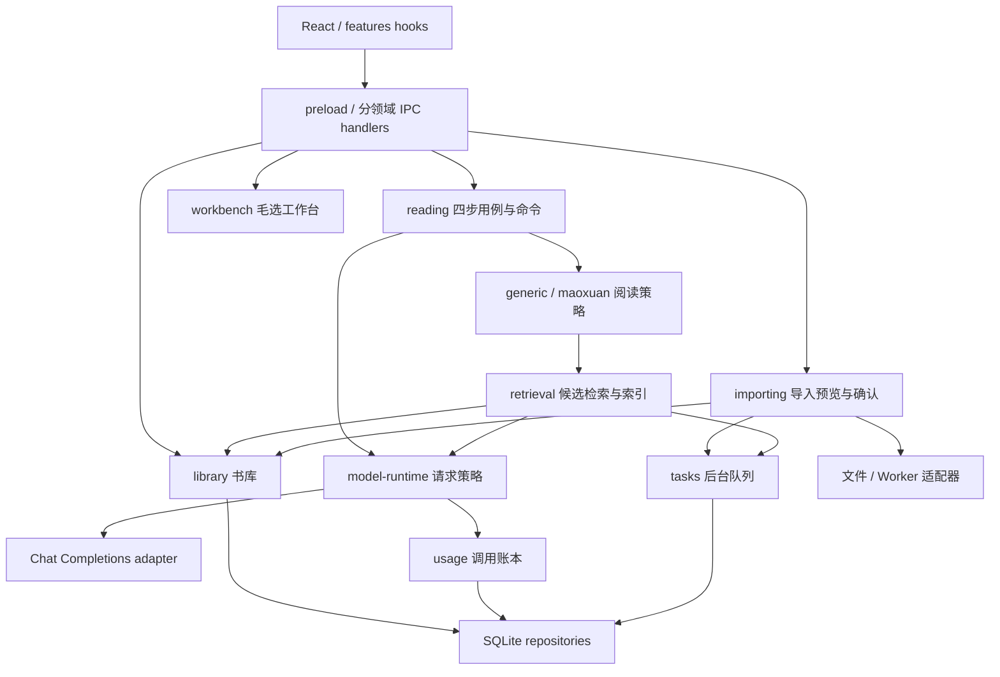

# 问题式阅读工具箱：当前架构

更新：2026-10-19，应用版本 0.3.0。产品范围见 [多书籍阅读方案](docs/multi-book-reading-plan.md)，详细设计约束见 [架构决策](docs/multi-book-architecture.md)，验证及首版边界见 [实施记录](docs/multi-book-implementation.md)。

应用继续采用 Electron + React + SQLite 的模块化单体。主进程保存正式数据、执行来源验证和模型调用；preload 暴露类型化 IPC；前端维护页面草稿和状态投影。



## 模块位置

| 路径 | 职责 |
| --- | --- |
| `src/main/index.ts`、`bootstrap.ts` | 启动、数据库初始化、依赖组装、窗口 |
| `src/main/ipc.ts` | 注册各领域传输入口 |
| `src/main/adapters/electron/` | 书籍/阅读/会话/工作台/设置/聊天 IPC、文件对话框与后台 worker |
| `src/main/adapters/importing/parser.ts` | EPUB/TXT 格式、编码、目录与正文解析 |
| `src/main/adapters/sqlite/` | 版本化迁移、书库、会话、任务、模型配置、索引及用量 repository |
| `src/main/adapters/model/` | 模型 HTTP 协议及 SSE 解析 |
| `src/main/modules/library/` | 书库读写契约、不可变正文与范围查询 |
| `src/main/modules/importing/` | 导入预览、章节编辑、确认及任务编排 |
| `src/main/modules/retrieval/` | 查询扩展、候选排序、分块摘要、缓存与续跑 |
| `src/main/modules/reading/` | 阅读命令、来源校验、generic/maoxuan 策略 |
| `src/main/modules/model-runtime/` | 调用上下文、配置快照、并发、取消、重试、Token 归一化 |
| `src/main/modules/model-config/`、`usage/`、`tasks/` | 模型配置、调用账本、后台生命周期，各自通过注入的 repository 持久化 |
| `src/main/modules/workbench/` | 原毛选工作台的分析与提示词，保持独立 |
| `src/shared/contracts/` | 书籍来源、任务、命令、模型及用量 DTO |
| `src/renderer/src/features/` | 书籍共享查询、任务订阅与恢复、用量页面 |

领域模块不直接访问 Electron、文件系统或 SQLite；原文解析与模型协议放在适配器。模块启动时由 bootstrap 注入依赖，跨模块使用 public 入口。`npm run check:boundaries` 检查模块依赖及循环。

## 来源与存储

每次确认导入生成不可变书籍/正文版本；重复文件按 hash 去重，同名不同文件可并存。当前书籍元数据直接持有其唯一 revisionId，首版不提供在同一书籍 ID 下替换正文的操作。

- `books`、扩展后的 `articles`、`paragraphs`：书籍、阅读单元和稳定段落 ID；不全量缓存正文。
- `chapter_index`、`index_blocks`：可重建的章节与块索引，包含内容/模型/prompt 签名。
- `sessions`、`versions`、`messages`：问题、阅读快照、对话；书籍上下文保存在 SessionData 中。
- `tasks`：后台状态及进度；`model_calls`：逐次调用用量；`model_profiles`：脱敏配置和加密凭据。

旧毛选会话读取时补齐内置书籍上下文，保留原文章 ID 和段落下标；段落 ID 在原顺序上生成。启动同步只初始化内置书，不清空上传内容。数据库迁移前创建 `maoxuan-before-multibook.db` 备份，迁移在事务内执行。

导入预览文件在应用 userData/import-previews 下管理，保存 7 天，可从最近任务重新打开；确认后的正式正文在数据库中独立存在。隐藏书籍不删除旧会话依赖的来源。

## 会话与并发

阅读页面将变更转成类型化命令，主进程基于最新状态应用，在事务中执行来源验证和历史保存。`stateVersion` 是并发版本，`versionNo` 是用户历史快照号，二者独立。

已有 `sessions.update` 供工作台、重命名/归档及旧脚本兼容，仍使用同一底层事务和来源校验；新增阅读功能使用 `reading.apply`，不新增整份 JSON 的写入通道。旧兼容入口的全面收窄作为后续独立兼容性工作，不同时重做工作台。

AI 生成与确认分离；请求完成时检查问题是否变化，页面应用诊断时再次校验当前问题。原文范围、感悟段落、推荐、重读和行动来源均在主进程验证。泛用书籍的旧诊断字段 mainContradiction/stage 暂作兼容字段，显示为关键障碍/约束信息，通用 prompt 不要求使用毛选术语。

## 任务与模型

后台任务有 queued/running/succeeded/failed/cancelled/interrupted 状态。任务状态在 SQLite，controller 和队列在内存，前端订阅事件并定期查询快照；切换页面不停止任务。重启识别中断，由用户显式继续索引，已完成块按签名复用；不自动重发结果未知的远程请求。

模型调用最多 3 个同时执行，后台任务最多 2 个，交互请求在等待队列中优先。HTTP 和流式响应统一通过模型 adapter；只有 runtime 做传输重试，已输出的流不自动重放。用量逐次计量，包含重试、失败和取消；服务商 usage 优先，缺失时明确估算或未知。记录失败进行有界待写入重试，不重跑模型；应用崩溃仍可能使部分记录不完整。

默认支持 DeepSeek/OpenAI-compatible Chat Completions，可保存多个命名配置。密钥不通过读取配置接口回传渲染进程，写入时使用 Electron safeStorage 加密；开发环境可继续通过本地 .env 提供默认值。阅读、工作台和索引可分别选择模型；其他协议及精确费用预算尚未开放。

## 验证与开发

```sh
npm run dev
npm run verify          # 依赖边界 + 单元/SQLite集成 + 类型检查 + 构建
npm run test:smoke      # 独立测试库、真实 Electron、模拟模型、UI 与 IPC
npm run dist           # 当前 macOS 架构 DMG
npm run dist:win       # Windows x64 NSIS；在 Windows runner 执行
```

测试通过 Electron 的 Node 运行模式执行，保证 better-sqlite3 ABI 与桌面应用一致。开发测试可用 MAOXUAN_USER_DATA 指向隔离目录；MAOXUAN_TEST 禁止加载项目 .env。测试截图写入被 Git 忽略的 output/qa。
