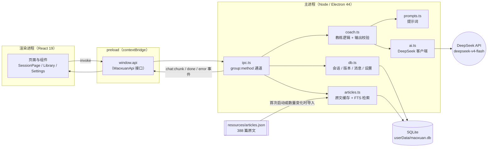
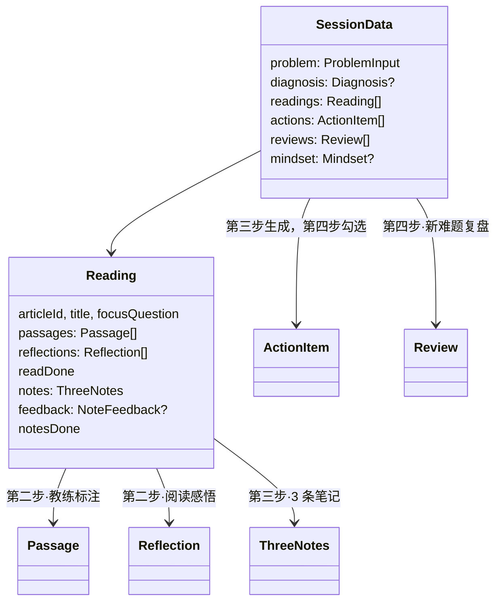
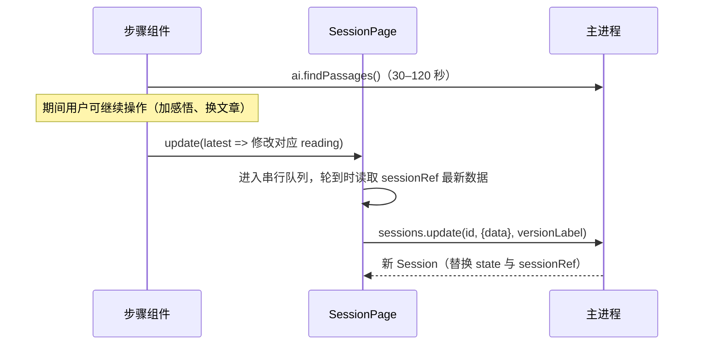
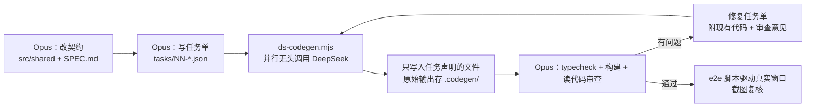

# 毛选实用工具箱 — 架构说明

产品规格见 `SPEC.md`，本文只讲“代码怎么组织、数据怎么流动、项目怎么开发”。

## 1. 总览



- **安全边界**：`contextIsolation: true`、`nodeIntegration: false`。渲染进程拿不到 Node 和 API Key，只能调用 `window.api`；所有 AI 请求都从主进程发出。
- **契约先行**：`src/shared/` 是三层共用的“合同”，改动功能先改这里，再改实现。

## 2. 目录

```
maoxuan-app/
├─ SPEC.md / ARCHITECTURE.md
├─ package.json  electron.vite.config.ts  tsconfig.node.json  tsconfig.web.json
├─ resources/articles.json         由 scripts/extract_epub.py 从 epub 生成
├─ scripts/
│  ├─ extract_epub.py              epub → articles.json（跳过空的时期分隔页）
│  ├─ ds-codegen.mjs               无头调用 DeepSeek 写代码
│  ├─ e2e.mjs / e2e-ui.mjs / e2e-v02.mjs   通过 CDP 驱动真实窗口的端到端测试
├─ tasks/                          给 DeepSeek 的任务单（JSON）+ 渲染层约定
└─ src/
   ├─ shared/                      契约：types.ts（数据）、api.ts（window.api）、core.ts（核心五篇等常量）
   ├─ main/                        index.ts · db.ts · articles.ts · ipc.ts · ai.ts · prompts.ts · coach.ts
   ├─ preload/                     index.ts（暴露 api）· index.d.ts（Window 类型）
   └─ renderer/src/
      ├─ App.tsx  main.tsx  styles.css（全局变量与基础类）
      ├─ pages/                    HomePage · SessionPage · LibraryPage · LibraryArticlePage · SettingsPage
      ├─ components/
      │  ├─ Sidebar · Stepper · DontsTicker
      │  ├─ ArticleReader          原文阅读器（段落编号、标注高亮、段落关联）
      │  ├─ ReflectionPanel        第二步阅读感悟框
      │  ├─ ChatPanel              教练对话（流式）+ “套用到第一步”入口
      │  ├─ VersionPanel           版本时间线、快照、对比、恢复
      │  ├─ ReviseDialog           第一步“套用讨论结果”逐字段对比弹窗
      │  └─ steps/                 StepProblem · StepFocus · StepRelate · StepApply · types.ts（StepProps、门槛）
      └─ lib/diff.ts               SessionData 扁平化与字段级差异
```

## 3. 数据模型

一个“会话”就是一个头疼的问题。整个四步流程的状态都在 `SessionData` 这一个 JSON 里：



SQLite 表：

| 表 | 用途 |
|---|---|
| `sessions` | 当前状态：标题、当前步骤、`data`（SessionData JSON）、`version_no`、`status`（active / archived）、`deleted_at`（回收站时间，非空即在回收站） |
| `versions` | 每次关键动作的完整快照（`session_id + version_no` 唯一），支持对比与非破坏式恢复 |
| `messages` | 教练对话记录 |
| `settings` | API Key、Base URL、模型（缺省回退 `.env`） |
| `articles` + `articles_fts` | 原文与 FTS5 trigram 全文索引（少于 3 字回退 LIKE） |

**关闭问题**：侧栏 × 弹出 `CloseSessionDialog`，可选归档或移入回收站。侧栏只列进行中的问题。「设置 → 回收站与归档」（`TrashPanel`）负责恢复、取消归档和彻底删除。主进程启动时和每 6 小时清理一次回收站里超过 `TRASH_RETENTION_DAYS`（30）天的问题，版本和对话随之级联删除。

**版本规则**：`sessions.update(id, patch, versionLabel?)`，给了 `versionLabel` 才写快照。随手的输入（感悟、行动结果）不写快照，“诊断、标注、读完、批改、保存笔记、完成行动、复盘、心法、套用讨论”都写快照。恢复旧版本会新增一个“恢复自 vN”的版本，历史不删除。

**兼容旧数据**：`db.ts` 读取时补齐新增字段（如 `reflections`），新增字段时照此处理即可。

## 4. 关键流程

### 4.1 保存与并发



步骤组件拿到的是 `save(data)`（直接保存）和 `update(fn)`（基于最新数据修改）。**凡是在 await 之后才保存的地方必须用 `update`**，否则会覆盖用户在等待期间的改动。

### 4.2 AI 调用

| 调用 | 输入 | 程序侧校验 |
|---|---|---|
| `diagnose` | 问题三字段 + 核心五篇表 | 推荐只保留核心五篇 id，标题由常量回填；为空时关键词兜底 |
| `reviseProblem` | 问题 + 诊断 + 最近 30 条对话 | 缺失字段回退旧值；没有改动说明时按字段差异自动生成 |
| `findPassages` | 问题 + 诊断 + 带编号段落（超 6 万字按关键词筛段） | 引用必须是原文子串，否则重新定位段落或标记“未核对” |
| `reviewNotes` | 问题 + 标注段落 + 阅读感悟 + 3 条笔记 + 评分锚点示例 | 分数钳制 0–5，是否及格由程序按“三项都 ≥3”重新计算 |
| `reviewSituation` | 全部 SessionData + 全书目录 + 新情况 | 推荐 id 必须存在于文章库 |
| `mindset` | 全部 SessionData | 补生成时间 |
| 对话（流式） | 会话摘要（含感悟）+ 正在读的文章标注 + 最近 20 条 | 只取 `content`，忽略推理模型的 `reasoning_content` |

所有提示词共享 `BASE_RULES`（“四不要”）：不替用户总结、不代写笔记、引用原文一字不差。

### 4.3 工作台模式

新建问题时二选一：**阅读法**（原有四步，`mode='reading'`）或**工作台**（`mode='workbench'`，数据在 `SessionData.workbench`）。`SessionPage` 遇到工作台会话直接交给 `WorkbenchPage`，两套页面互不影响。

| 步骤 | 调用 | 要点 |
|---|---|---|
| 1 摸清事实 | `wb.intake` | 表单转成事实台账，分事实 / 判断 / 愿望，编号 F1、F2… 只增不改；缺什么就追问 |
| 2 三路诊断 | `wb.contradiction` / `wb.routes` / `wb.objSubj` | 三个分析各自只看事实台账，互不参考；引用的 F 编号由程序校验 |
| 3 综合决策 | `wb.decide` / `wb.recheck` | 硬规则（`ruleChecksDecision`，F/C/R/O/D 系列）+ AI 红队；未通过项可修复或由用户豁免 |
| 4 行动复盘 | `wb.actions` / `wb.recap` | 7/30/90 天行动须有验证、执行标准、KPI 关系（`ruleChecksActions`）；复盘结论只追加到项目台账 |

- 规则常量、原文依据（`WB_SOURCES`，均已核对原文）和门禁函数在 `src/shared/workbench.ts`，提示词在 `src/main/wbPrompts.ts`（`WB_RULES`：不用毛泽东第一人称、结论写成条件式、给人看的文字不出现英文键名）。
- `src/main/workbench.ts` 遇到网络闪断会自动重试一次，超时不重试。
- 对话复用 `ChatPanel`，工作台传入「参谋对话」的标题、开场白和快捷问题，系统提示由 `buildWbChatSystem` 生成。
- 端到端测试：`PORT=9336 node scripts/e2e-wb.mjs`（`RESUME=1` 接着测已有示例）。

## 5. 开发方式：Opus 指挥 + DeepSeek 写代码



- 任务单字段：`name`、`files`（允许写入的文件白名单）、`context`（附带的现有文件）、`instructions`。脚本总会附带 `SPEC.md` 与 `src/shared/*`。
- 并行任务之间的接口（函数签名、组件 props、CSS 基础类）必须写进任务说明或 `tasks/_renderer-contract.md`。
- 修复任务一律“附上现有文件 + 最小修改”，避免整文件重写引入新问题。
- 依赖版本与构建配置由指挥方维护，不交给 DeepSeek（它不了解 Electron 44 / Vite 7 等新版本）。

## 6. 常用命令

| 命令 | 作用 |
|---|---|
| `npm run dev` | 开发模式启动（热更新） |
| `npm run typecheck` | 主进程 + 渲染进程类型检查 |
| `npm run build` | 构建到 `out/` |
| `npm run dist` | 打 macOS 安装包（尚未实测） |
| `npm run extract` | 重新从 epub 生成原文数据 |
| `npm run codegen -- tasks/xx.json [...]` | 调用 DeepSeek 执行任务单 |
| `npx electron . --remote-debugging-port=9333` 后 `node scripts/e2e.mjs` | 端到端测试（真实调用 DeepSeek） |
