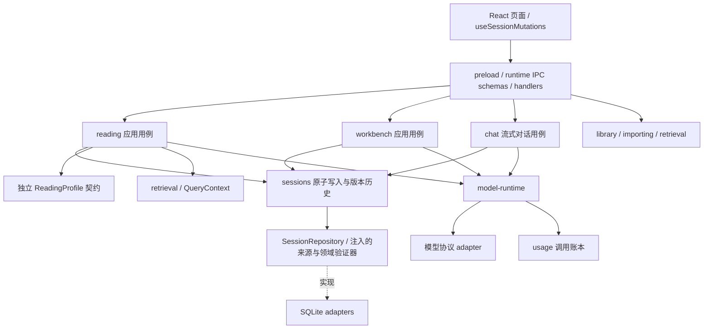

# 问题式阅读工具箱：当前架构

更新：2026-10-19。Electron + React + SQLite 模块化单体。产品范围见 [多书籍方案](docs/multi-book-reading-plan.md)，早期设计见 [架构决策](docs/multi-book-architecture.md)。本文件描述当前实现；重构说明见 [架构演进记录](docs/architecture-evolution.md)。

## 依赖与职责



模块通过 `public.ts` 协作。跨模块类型也从 public 入口导出。`bootstrap.ts` 负责组装端口和领域验证器；sessions 不反向依赖 reading/workbench。`createSessionService` 创建独立应用实例，桌面 public facade 绑定一个应用生命周期实例。其余已有模块保留启动时注入的单实例 facade，不引入 DI 框架。

| 模块 / 路径                                 | 拥有的职责                                                                               |
| ------------------------------------------- | ---------------------------------------------------------------------------------------- |
| `modules/sessions`                          | 会话创建、原子变更、乐观锁、幂等回执、生命周期、快照恢复、对话存储接口、版本化 JSON 迁移 |
| `modules/reading`                           | 阅读意图命令、步骤规则、来源真实性、建议生成与确认校验、generic / maoxuan 策略           |
| `modules/workbench`                         | 工作台命令、事实/诊断/决策/行动、候选与纳入状态的领域规则、只追加台账、建议适用性与确认规则 |
| `modules/chat`                              | 对话上下文、模型流、消息持久化与清空后的迟到回复处理                                     |
| `modules/library`                           | 不可变正文、书籍和章节来源接口                                                           |
| `modules/importing`                         | 解析预览、编辑确认、导入编排                                                             |
| `modules/retrieval`                         | QueryContext 检索契约、章节与分块索引、缓存和续跑                                        |
| `modules/settings` / `model-config`         | 旧设置兼容与环境默认值 / 多模型配置与用途路由                                            |
| `modules/model-runtime` / `usage` / `tasks` | 模型请求策略 / 用量账本 / 后台任务生命周期                                               |
| `adapters/sqlite`                           | 连接和数据库迁移、分模块 SQL repository；不决定会话业务规则                              |
| `adapters/electron`                         | 对话框、Worker、IPC 参数校验和事件投递；不负责 AI 适用性判断                             |
| `shared/contracts`                          | 跨进程 DTO、意图映射、运行时 schema；不含权威状态 reducer                                |
| `renderer/features/sessions`                | 两种页面共用的串行命令队列、会话切换保护、服务器状态投影                                 |

## 写入和并发

阅读内容只经过 `reading.apply`，工作台内容只经过 `wb.apply`。阅读已有 saveNotes、reflection、actionProgress 等意图；工作台按表单、事实、诊断模块、决策、行动和台账划分命令。行动上区分普通字段编辑与显式的 `enqueueActions`、`returnActionsToCandidates`、`createQueuedAction`：纳入状态只能由这些命令改变，普通 `action` 更新不能顺手把候选改成已纳入。`sessions.update` 仅接收标题、步骤、归档状态等元数据，运行时和类型层面都不再接受 `data`。

所有内容写入和历史恢复必须携带 `expectedStateVersion` 和 `mutationId`。preload 为未显式指定 mutationId 的调用生成 ID；需要重试原请求的调用方应复用同一个 ID。SQLite 事务包含：回执查询 → 版本检查 → 命令应用 → schema/来源/建议/步骤验证 → 状态更新 → 可选快照 → 回执写入。相同 ID 携带不同内容会被拒绝；完全无变化的命令不追加重复快照。恢复历史版本始终新增一份恢复记录。

`stateVersion` 表示并发状态版本，`versionNo` 表示用户快照编号，两者独立。归档和回收站操作也递增 stateVersion，避免旧页面之后覆盖生命周期状态。React 队列仅用于本页面操作排序；跨入口冲突最终由主进程判断，冲突不会自动用最新版本重试覆盖用户数据。

## 工作台行动：候选与待办

工作台行动有两个正交字段：`planningState` 表示是否被用户纳入工作清单（`candidate` / `queued`），`status` 表示执行结果（`todo` / `done` / `dropped`）。模型生成、工作台第四步手工新增都只产生候选；用户勾选后由 `enqueueActions` 一次性批量纳入。候选不能完成、放弃或写入阶段进展，主进程命令 reducer 与最终状态不变量都会拒绝这类写入。批量操作整批校验、整批失败，缺失 ID、非法状态和跨会话 ID 都不会被静默跳过；一次提交对应一个命令、一个事务和一份版本快照。

`collectActions` 只投影 `planningState === 'queued'` 的工作台行动，因此工作清单、四象限、侧栏计数和 AI 自动分类天然使用同一份“已承诺”集合；工作台第四步直接读取 `wb.actions` 以展示完整候选池。从工作清单手工创建工作台任务使用 `createQueuedAction`，主进程补齐 `queued + todo` 并拒绝覆盖已有 ID。纳入/撤回只改 `planningState`，保留来源上下文、周期、KPI、执行标准、象限和日期；撤回只允许未完成、未放弃且没有阶段记录的已纳入行动。

批量命令只携带行动 ID、不携带文本，因此编辑表单有未保存修改时，加入待办与移回候选在提交前统一拦住（工具栏显示“先保存或取消编辑”，提交函数内再保护一次），避免把数据库里的旧文本当成用户刚筛过的修订推送出去。AI 行动审核输入按执行状态分区（候选策略 / 当前待办 / 已完成 / 已放弃）并逐条标注，多线作战只统计“当前待办”，与本地 A-5 规则使用同一口径。

## AI 建议与来源

生成和确认是两个阶段，规则在 reading/workbench 应用用例中，不按 IPC 通道名称触发业务逻辑。建议携带 requestId、sessionId、书籍版本、profileVersion、用途及输入指纹。指纹由领域模块按实际依赖选择字段；三个工作台诊断只依赖表单和事实台账，可以并行完成。笔记反馈绑定已保存的笔记、感悟、选段和章节；问题修订还校验讨论记录。

生成返回时和确认写入时均检查适用性。已经接受的结果保留生成时的来源信息，后续手动编辑不伪装成重新生成。IPC 和归一化后的建议结果都有运行时结构验证；TypeScript 泛型本身不视为模型返回的真实性保证。原文引句、章节归属和段落 ID 在主进程再次校验并规范化。

`ReadingProfile` 是独立接口，不再借用 maoxuan 实现的 typeof 作为公共协议。generic 新诊断和心法使用 `analysis.obstacle/constraints`；旧 mainContradiction/stage 字段保留空兼容槽，历史数据由迁移和展示适配转换。毛选专属提示词和常量留在专用策略及工作台中。

## 持久化与升级

数据库版本使用 `PRAGMA user_version`，当前为 3；会话 JSON 使用独立 `schemaVersion`，当前为 3。正式会话和历史快照共用同一个逐版本解码入口。未知未来版本被拒绝，避免静默降级写坏数据。旧感悟/行动默认字段、内置书籍上下文、历史多余的 SourceRef 字段和旧工作台行动的纳入状态只在兼容迁移中处理：v2 → v3 把所有旧行动标记为 `queued`，因为无法只凭 `status: todo` 判断用户是否真的从未执行；升级不会自动清空既有待办，用户可在第四步主动移回候选。

数据库升级前通过 SQLite 的 `VACUUM INTO` 创建 `maoxuan.db.before-vN` 备份；迁移按版本在事务内执行。密钥通过注入的系统加密适配器保存，配置读取不向 renderer 回传密钥。

会话摘要持有 book_id/book_title，列表不读取正文 JSON；requireBook 只查询目标书。FTS 用 INSERT/UPDATE/DELETE 触发器增量维护，升级时重建一次，不在每次导入时重建全库。

确认后的正文版本不可变；隐藏书籍保留旧会话来源。当前一本书仍只有一个 revisionId，重新导入另一文件形成另一书籍；不承诺同一书籍多版替换或跨版笔记映射。

## 任务和执行边界

解析在 Worker 中执行。后台任务保存状态、进度和索引检查点，重启后识别 interrupted，由用户继续；不自动重发结果未知的远程请求。模型 runtime 统一负责并发、取消、传输重试和用量记录。

SQLite 目前仍是主进程同步连接；批量确认导入仍可能占用主线程。已去除全库重建和全量 JSON 摘要解析，但没有做大书库性能承诺。需要更大规模时，应先测导入耗时和事件循环延迟，再将持久化执行器迁到 Worker。多端同步、协作冲突解决、远程存储不在当前桌面单体的支持范围内。

## 架构守护和验证

`check:boundaries` 使用 TypeScript AST 和模块解析扫描完整 src，检查 import/export/dynamic import/require、别名、跨进程依赖、模块方向、public 入口和运行时循环；不再仅正则扫描 modules。前端和 shared 禁止 Node/Electron/数据库依赖，IPC 禁止直接引用 SQLite adapter。规则自身有反例测试。

```sh
npm run verify      # 架构检查、单元/SQLite回归、类型检查、构建
npm run test:smoke  # 隔离 userData、真实 Electron、模拟模型、React/IPC
```

回归覆盖竞争写入、幂等和回滚、来源校验、schema 升级/恢复（含 v0/v1/v2 → v3 连续迁移与快照恢复）、旧 AI 结果、工作台并行分析，以及候选/待办的批量纳入、原子失败、撤回限制和聚合过滤。完整 smoke 覆盖通用阅读和工作台四步、毛选诊断兼容、原书库、索引复用、用量及历史恢复，不访问用户正式数据库，也不调用真实模型。PR 工作流执行 verify 和 Electron smoke；Windows 安装包工作流继续验证其平台构建。
