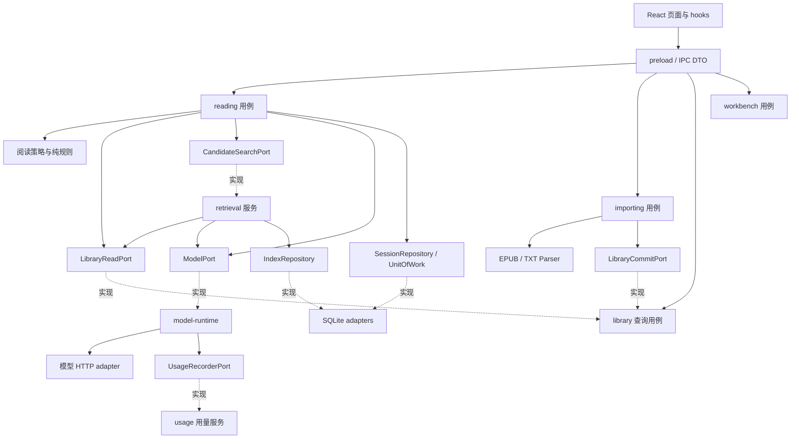

# 多书籍阅读架构决策

日期：2026-10-14。状态：拟采用的目标架构，尚未实现。

2026-10-16 修订补充：总体实施阶段与 EasyPPT 对照见 [实施计划第 8 节](multi-book-reading-plan.md#8-参考-easyppt-后确定的应用架构)。任务执行增加独立 tasks 能力，生命周期不归阅读策略；创建会话即绑定书籍版本。修订前检查点为 `6ee7fa8` / `checkpoint/pre-multi-book-20261016`。

## 1. 判断与架构选择

当前代码已有 Electron 主进程 / preload / React 分层，但进程隔离不等于业务低耦合。
`articles.ts` 混合内置导入、缓存、读取、搜索；`ipc.ts` 混合通道和业务编排；`coach.ts` 及提示词直接依赖毛选常量；`db.ts` 混合多个业务的数据访问和部分规则。因此不能认定当前架构已满足多书场景的高内聚、低耦合。

采用模块化单体：一个应用、一个数据库连接，由明确接口隔离业务模块。无需微服务、消息中间件、通用插件系统或全套依赖注入框架。按职责和变化原因划分，不为每个函数增加抽象层。

## 2. 模块职责及数据所有权

| 模块 | 对外能力 | 自己负责的数据与规则 | 不承担 |
| --- | --- | --- | --- |
| library 书库 | 列书、列章节、按来源读取正文、提交新书籍版本、隐藏书籍 | books、book_revisions、chapters、paragraphs；正文不可变；来源归属校验 | 文件格式解析、推荐、会话进度 |
| importing 导入 | 解析预览、确认导入、请求取消/重试 | 临时文件、预览及业务结果；编码与格式适配、内容规范化；任务状态委托 tasks | 阅读会话、AI 选章 |
| retrieval 检索 | 构建索引、查询候选 EvidenceSet | 检索块、FTS、摘要缓存、块处理检查点；索引版本及预算；任务状态委托 tasks | 修改原文、作最终推荐、写会话 |
| reading 阅读 | 创建问题、四步命令、生成建议、确认结果、版本恢复、陪读 | 阅读会话、感悟、行动、版本、对话；书籍绑定、阶段规则、并发校验 | EPUB/TXT 细节、SQL、HTTP |
| reading/profiles 阅读策略 | 提示词、候选规则、反馈维度、示例与界面提示 | generic 与 maoxuan 两种策略的差异 | 直接读库、发请求、写状态 |
| model-runtime 模型运行 | 统一模型入口、请求策略、取消、流事件、用量采集 | 调用上下文、配置快照、单次 attempt 生命周期 | 推荐规则、写阅读状态、直接查询统计表 |
| usage 用量 | 记录调用、查询聚合与预算状态 | 调用账本、Token 来源、统计口径及价格快照 | 构造 prompt、解析书籍、决定阅读步骤 |
| tasks 任务执行 | 排队、状态查询、进度通知、取消、重试与中断识别 | task_runs/task_items、任务预留、检查点协议、统一收尾 | 判断章节相关性、修改阅读步骤、充当原文存储 |
| workbench 工作台 | 现有毛选项目决策用例 | 工作台规则和会话状态 | 通用阅读策略、导入处理 |
| adapters 外部适配 | SQLite、模型 HTTP、文件选择、后台任务执行 | 技术实现、事务、取消、连接、错误转换 | 产品推荐规则 |
| ipc 传输 | 校验输入、调用用例、返回 DTO、发送进度/流事件 | 通道协议和传输错误 | 读取全库拼 prompt、推荐兜底、直接编排多步业务 |

共用数据库连接不意味着模块可以任意读写彼此的表。业务模块通过窄接口协作；模块专属 SQL 放对应 repository 适配器。数据库迁移统一版本化执行。

## 3. 依赖方向



规则：

- domain 纯规则不 import Electron、SQLite、文件系统、模型客户端或 React。
- application 用例依赖 domain 和自身声明的 ports；具体适配器在 `main/bootstrap.ts` 组装。
- importing 不 import reading；retrieval 不 import reading；library 不 import retrieval 或 reading。检索的输入是 QueryContext，不是整份 SessionData。
- reading 不知道文件是 EPUB 还是 TXT，只拿标准正文与来源引用；策略不访问外部服务。
- renderer 只依赖 IPC DTO 与纯 UI 元数据，不引入 main 模块。客户端 AI 结果只是待确认建议，不能直接覆盖会话。
- 只有 maoxuan profile 和 workbench 能导入毛选专用常量。其他阅读模块不可按书名判断策略。

## 4. 稳定契约

最重要的共同契约是不可变来源，而非一个巨大的共享 Book 对象。

```ts
type BookScope = { bookId: string; revisionId: string }

type SourceRef = BookScope & {
  chapterId: string
  paragraphId: string
  // 均相对于规范化后的不可变段落正文
  startOffset?: number
  endOffset?: number
}

type Candidate = {
  chapterId: string
  title: string
  path: string[]
  excerpts: Array<{ source: SourceRef; text: string }>
}

interface BookParser {
  parse(input: ImportInput, signal: AbortSignal): Promise<ParsedBook>
}

interface CandidateSearchPort {
  search(scope: BookScope, query: QueryContext, budget: SearchBudget,
    signal: AbortSignal): Promise<Candidate[]>
}
```

以上为契约草案，具体 DTO 字段在实施时定稿；不承诺当前代码已有这些类型。

- LibraryReadPort 仅返回所请求版本的章节/段落；读正文前校验章节属于指定版本。原文阅读与 AI 引用验证共用这一个真相来源。
- AI 返回的 ID、引文及理由都视为不可信输入；reading 的通用证据校验必须经过 LibraryReadPort，策略不能绕过它。
- 模型客户端只负责 JSON/流式响应、超时、取消与用量；不包含“推荐 3 篇”“核心五篇”等产品规则。
- ModelPort 的具体实现由 model-runtime 装饰模型 adapter，统一处理调用策略与用量。业务模块不直接 fetch 模型服务，也不自行统计 Token；usage 不反向依赖 reading/retrieval。
- 领域类型留在各模块；`shared/contracts/` 只放跨进程 DTO、事件和少量来源类型。DTO 与库表结构之间显式转换。
- 模型建议对象携带 requestId、sessionId、contextVersion、problemRevision、bookRevisionId、profileVersion；确认时检查其适用上下文。

## 5. 四步流程与阅读策略

共用：书籍绑定 → 明确问题 → 选择阅读内容 → 原文/感悟 → 联系自身 → 行动/复盘；共用保存、引用、并发、版本规则。

策略集中在两处实现：

- maoxuan：核心五篇、专用诊断术语、评分锚点、毛选示例。
- generic：问题澄清、正文候选推荐、通用反馈、开放的反思与实践。

ReadingProfile 提供 prompt 构造、候选约束、反馈准则及 UI 提示 DTO。增加策略时不得复制整套页面，也不得在每个页面散布 `if (bookId === ...)`。策略只处理真正不同的部分，不设计可任意编排步骤的工作流引擎。

通用诊断以 problemSummary、constraints、openQuestions 等中性字段表达；毛选的 mainContradiction/stage 属于专用分析。若沿用当前字段作为过渡，必须标注兼容层和移除节点，不能长期将所有书强塞进同一套毛选语义。

策略版本随诊断/版本快照保存。历史记录显示保存时的结论；重新生成明确采用当前策略，不声称复现模型当年的输出。

## 6. 写入、并发及生命周期

阅读会话是用户状态的写入边界；整本正文、索引、HTTP 客户端不放入 SessionData。

- React 局部维护输入草稿，业务变化发送明确命令，如 addReflection、saveNotes、recordActionResult、applyDiagnosis。
- 主进程读取最新状态、验证命令、合并变更，并在同一事务更新会话及必要版本快照。逐步收窄目前允许前端任意替换 SessionData 的 update 接口；旧接口通过兼容 facade 迁移。
- 使用独立 stateVersion 乐观锁检测写入竞争，versionNo 继续只表示用户历史快照编号，二者不能混用。
- AI 生成与应用结果分离。调用模型期间不持有数据库事务；结果返回时检查问题版本和书籍版本。只新增感悟不一定使推荐失效，用请求实际依赖字段的 contextVersion 判断，避免任何编辑都导致无效重试。
- 结果应用按 requestId 幂等，防止重试生成重复快照。切换会话或取消请求不能把迟到结果写入新问题。
- 书籍版本一旦确认导入，其正文、段落顺序与来源 ID 不再变；重新解析产生新版本。索引可重建，不能改写正文。
- 一次导入的版本、章节、段落在事务内发布；用户只看到完整可用版本。索引就绪是独立状态，索引失败不撤销可读的正文。
- 第一版书籍删除使用隐藏。存在当前会话或历史快照引用时，不物理删除对应版本。全局数据维护用例可在事务内检查引用并清理；library 不反向调用 reading。
- 引用、来源 hash 与摘要缓存版本联合保证历史来源稳定；不同模型或索引版本生成的摘要不能无条件共用。

导入解析和索引任务使用有界后台执行器；状态可查询，进度事件只是通知。任务支持取消、失败重试和应用重启后的恢复，任务状态与业务提交分别管理。

## 7. 建议目录及渐进迁移

```text
src/main/
  bootstrap.ts                 # 唯一组装入口
  modules/
    library/                   # public facade、domain、application、ports
    importing/                 # 导入用例、EPUB/TXT parser
    retrieval/                 # 候选检索、索引任务
    reading/                   # 会话用例、纯规则、profiles/{generic,maoxuan}
    workbench/                 # 独立工作台用例
    model-runtime/             # 调用上下文、策略、流式、用量采集
    usage/                     # 调用账本、聚合、预算查询
    tasks/                     # 共用的任务生命周期与状态协议
  adapters/
    sqlite/                    # 分模块 repository + 事务 + migrations
    model/                     # 模型请求与流式接口
    electron/                  # 对话框、后台执行、IPC handlers
src/shared/contracts/          # IPC DTO、SourceRef、进度事件
src/renderer/src/features/
  library/                     # 书架与导入 UI
  reading/                     # 四步页面与 hooks
  workbench/                   # 工作台 UI
```

目录允许根据规模合并文件，不要求每个模块立即建完整的多层空文件夹。public facade 是稳定入口，模块外禁止深层导入内部实现。

迁移顺序：

1. 定义 SourceRef、BookScope、BookParser、候选检索契约及 reading profile；标明旧契约适配方式。
2. 迁移书籍版本与段落来源，提取 library，保留原 articles API facade；验证旧原文和历史感悟一一对应。
3. 提取 SQLite repositories、事务与迁移；IPC 分组为薄 handlers，业务编排迁入 reading 用例。
4. 提取 maoxuan profile，先用现有毛选流程验证行为一致，再加入 generic。不可先复制 coach.ts 作为另一套引擎。
5. 独立实现 importing、retrieval，接入书架和选书。逐步改用业务命令，禁止新增整份 SessionData 写入入口。
6. 删除被替代的兼容入口和重复规则。迁移范围内的旧 facade 必须列出消费者、替代入口和删除阶段，避免永久双轨。

## 8. 怎样验证高内聚、低耦合

满足下面的变化范围与检查规则，才认为边界有效：

| 变化 | 主要改动范围 | 应保持稳定 |
| --- | --- | --- |
| 增加新的书籍文件格式 | parser + 导入预览适配 | 四步业务、推荐、感悟和行动模型 |
| 上传一本新书 | 数据导入 | 无需改程序或注册新策略 |
| 更换模型服务 | ModelPort adapter + 设置 | 文件解析、书库、会话保存 |
| 增加向量混合检索 | retrieval + 索引存储 | BookParser、四步 UI、会话命令 |
| 修改毛选核心篇或术语 | maoxuan profile | generic profile、导入、来源定位 |
| 增加一种阅读策略 | profile 实现、注册入口、专属 UI 元数据 | 共用原文读写、导入和四步状态机制 |

实施时纳入 CI 的验收门槛：

- 静态依赖检查：禁止循环依赖、业务模块引用 Electron/SQLite、前端引用 main、模块越过 public facade、非专用模块引用毛选常量。工具可选 ESLint 或 dependency-cruiser，在实施时择一。
- domain 测试无需启动 Electron、数据库或网络；application 用例可用内存 repository 与假模型验证。
- 真实 SQLite 集成测试验证迁移、事务回滚、来源归属、版本恢复和状态竞争；无需用 mock 证明 SQL 正确。
- 用带固定章节/引文的假模型测试编造引用、跨书推荐、过时结果和重复应用；推荐质量另用真实模型样书评估。
- 端到端分别走通 maoxuan/generic 四步及原工作台。高内聚不由文件数量或文件行数判断，而由一次变化需要同时修改的模块决定。

## 9. 本次定下的关键约束

1. 采用模块化单体，不增加分布式部署复杂度。
2. 格式解析、内容存储、检索候选、阅读规则四个变化点互相隔离。
3. 毛选是一个专用 reading profile，不作为所有书的基础假设。
4. 不可变书籍版本 + 稳定 SourceRef 是原文、感悟和复盘的共同基础。
5. 主进程用例拥有状态变更与校验，React 和 IPC 不承载核心业务编排。
6. 通过依赖检查和可替换契约验证边界，实施前不宣称已达到高内聚低耦合。

## 10. 参考 EasyPPT 的模型调用与 Token 统计

参考本机 `collections/2026y/easy-ppt-3` 的现有源码，已检查模型创建、用量采集、持久化、聚合、界面与相关测试。这是源码实现分析，不是对所有服务商行为或所有调用路径覆盖率的保证。

### 10.1 已确认的实现与取舍

| EasyPPT 源码 | 已确认的行为 | 本项目取舍 |
| --- | --- | --- |
| `src/main/agent.ts` resolveModel | 创建模型时注入 ModelUsageCallbackHandler，集中构造配置 | 在统一 ModelPort 入口采集，不要求引入 LangChain |
| `src/main/model-usage.ts` | 识别 usage_metadata、response_metadata.tokenUsage、llmOutput 与直接响应 usage 等字段；provider 优先；缺失时 estimated | 保留归一化，但按 adapter 明确字段映射，避免不相关字段误加；部分缺失不能伪造为精确零 |
| 同文件 callback/direct recorder | 框架回调和直接 HTTP 都能记录；记录失败仅告警；用全局 usageDb 保存配置 | 全部走同一 runtime 与 recorder；bootstrap 注入依赖，不沿用全局 DB 单例 |
| 同文件 countEstimatedTokens | 用字符串长度 / 4 估算；callback 错误时删除估算缓存，没有记录该次失败用量 | 中文改用匹配模型的 tokenizer 或明确标注的启发式估算；补失败/取消/中断状态 |
| `src/main/db/schema.ts` modelUsageEvents | 每条保存 provider、model、configId、输入/输出/总 Token、来源、时间 | 增加 operation/run/attempt ID、业务归属、状态、耗时和幂等键 |
| `src/main/db/database.ts` getModelUsageStats | today/7d/30d/all；按模型、日期、今日小时统计；区分 provider/estimated 次数 | 沿用统计入口，补书籍/问题/功能维度及未知用量覆盖率 |
| `src/renderer/src/components/token-usage/TokenUsageDashboard.tsx` | 用量页面展示输入/输出、模型与时间分布 | 第一版轻量用量页即可，无需照搬其完整图表依赖 |
| `src/main/model-runtime.ts` | AsyncLocalStorage 隔离温度、思考参数和配置 ID | 首版显式传入不可变 RequestContext，若深层回调确需 ALS，使用 run 作用域并验证并发隔离 |
| `src/shared/model-timeout.ts` | 按验证、规划、设计、agent、document 区分超时范围 | 用本项目的连接测试、推荐、正文标注、索引、聊天分类，参数不直接复制 |
| `src/main/utils/model-retry.ts` | 区分传输错误和需格式纠正的错误 | 分类重试，不能把网络超时当 JSON 格式问题发送纠错 prompt |
| `tests/unit/model-usage.test.ts` | 覆盖 provider 优先、缺失估算及直接调用 | 增加重试、流式尾包、部分 usage、失败、幂等和中文估算测试 |

当前毛选 `src/main/ai.ts` 的 JSON 响应忽略 usage，SSE 只提取 content，连接测试丢弃响应正文；`workbench.ts` 还自行负责部分重试。新增统一运行层必须覆盖这些路径以及后续索引，不能只统计陪读聊天。

### 10.2 调用链与责任

reading / retrieval / workbench → ModelPort → model-runtime → provider adapter。

model-runtime → UsageRecorderPort → usage → UsageRepository；界面 → usage 查询用例 → 聚合 DTO。

业务层传 purpose、scope、promptVersion、输入上下文和预算，runtime 管理实际模型配置、attempt、超时/取消与通用响应验证。阅读层继续负责推荐 ID、引用和笔记规则。传输错误在 runtime 处理；涉及重新构造业务 prompt 的修复由业务用例决定，但每次实际请求仍须经过 runtime。

模型服务成功返回后即记录已知 Token，即使 JSON、schema 或引文校验失败也属于消耗。用量写入失败不能让已成功生成的用户结果失败或触发模型重跑；应记录脱敏诊断，并通过本地待落库队列重试。队列写入也失败时标记统计不完整，不能承诺不丢账。

### 10.3 调用上下文与账本

建议上下文：operationId（一次用户操作）、runId（一次索引/推荐任务）、attemptId（一次真实请求）、attemptNo、purpose、sessionId?、bookId?、bookRevisionId?、profileVersion?、promptVersion、modelConfigId、signal、deadline。

purpose 至少区分：book_index、recommend、problem_revision、passages、notes_feedback、review、mindset、chat、workbench、connection_test。索引没有 sessionId 也能记账；本地缓存命中不算模型调用。

usage 拥有 model_call_attempts 表，至少包含：

- 唯一 attemptId、operation/run、重试序号、purpose 与可空的业务归属。
- provider、协议、实际返回的 model、调用时配置标识；配置快照不含 API Key。
- startedAt/endedAt、durationMs、流式首 Token 时间、HTTP/error 分类、finishReason、状态。
- transportStatus 与 validationStatus 分开：2xx 且内容格式不合法不能被统计为没有消耗。
- input/output/total Token，可空；usageSource 为 provider/estimated/unknown，usageCompleteness 为 complete/partial；估算算法版本。
- cacheRead/cacheWrite/reasoning Token（服务商可用时），原始 usage 的白名单字段，providerRequestId。
- 可选价格快照、币种与 estimatedCost；没有价格配置则费用未知。

字段引用书籍/会话用于归属，不随会话删除级联清除调用账本；可保留快照名称或显示已删除。账本不存原始问题、书籍全文、完整 prompt、认证头或原始错误响应。保留期限和清理用例由 usage 模块负责。

统计按 attemptId 唯一 upsert 完成，而不是每个流包插入一条。进程崩溃遗留的 started 记录重启后标记 interrupted/unknown，不推断已扣费数量；确需 provider 对账应使用独立适配能力。

### 10.4 Token 口径与流式细节

1. 真实 usage 优先；只有总量时记录总量，输入输出保持未知。若能够由总量及一个分量推导另一个，标注 derived，不称为服务商逐项回传。混合真实值和估算值必须分字段标明来源。
2. 没有 usage 才做估算；能拿到匹配模型的 tokenizer 就使用它，否则用中英文区分的启发式方法并保留 estimated 标签。消息包装、工具结构和不可见思考 Token 可能缺失，不能把估算当账单。
3. 推理 Token、缓存命中 Token 常是输入/输出内部分类，是否包含由 adapter 的服务商语义确定，不能再次累加进总量。
4. 流式 adapter 在支持时请求 usage，读取无 content/空 choices 的最终用量包；不能只在正文 delta 存在时解析。正确处理分包、结束标识、finishReason 与取消。
5. 若服务商给的是累计 usage，用最后完整值替换，不能逐包求和；只有明确为增量的协议才累加。底层 SDK/provider 只能选择一个权威记录入口，避免 callback 与 direct 双记。
6. 取消或断流可能发生在模型已消耗 Token 之后。保存已知 usage，缺失部分保持 unknown 或明确的局部估算；禁止把失败调用统一记零。
7. 调用次数区分用户操作次数与实际请求次数；一次推荐重试三次是一个 operation、三个 attempts，Token 按真实请求累计。

统计 API 返回今日/7天/30天/全部，可按 provider/model、purpose、书籍、问题筛选。聚合展示 provider/estimated/unknown 分布及缺失分量数量，部分用量之和标为“已知用量”。明确统计时区，默认用户当前时区；存储 UTC 时间，查询时统一计算日期边界，避免 SQL localtime 与 JS 时区不一致。

### 10.5 重试、预算与配置

- 用结构化错误分类区分认证、参数、限流、服务错误、连接失败、超时、取消、截断、格式校验失败；不以正则匹配错误文案作为唯一依据。
- runtime 是通用传输重试的唯一所有者，关闭或纳入 SDK 的隐式重试；取消和认证错误不自动重试。限流/瞬时错误使用有界退避和 Retry-After，超时后是否重试需考虑结果及计费未知。
- 已向用户显示流内容时，失败后不静默追加一次重跑的文本；返回 partial 状态，让用户明确重试。索引块可以独立重试和续跑。
- 分用途配置总时限、单次时限、最大输出、最大 attempts、并发数；明确模型上下文窗口与 tokenizer。请求前按预算裁剪，索引分块；输出截断按 finishReason 报错而非默认为合法完整结果。
- 调用开始冻结配置，用户在设置中换模型只影响后续调用。温度、思考参数、JSON 模式、流式 usage 支持属于 adapter 能力，不按域名一刀切。
- 多书索引消耗较大，第一版提供 Token 估算、索引进度、并发限制和暂停；预算警戒值是软控制，不承诺精确费用封顶。若做并发预算控制，需要为在途请求预留预算，并结算或释放预留。
- 价格采用显式配置和版本快照，服务商缓存/推理定价单独映射；没有可靠价格时只展示 Token，不硬编码当前价格。
- 统计默认本地存储，不复制 EasyPPT 的匿名遥测上报能力。

### 10.6 交付顺序与验收

在新增书籍索引前落地统一 runtime + usage，而不是各 AI 功能完成后再补统计。

第一阶段：调用上下文、JSON/流式 adapter、provider usage 归一化、调用账本、重试与取消；将现有阅读、工作台、连接测试都迁入。
第二阶段：purpose/书籍/问题聚合接口、轻量用量页面、估算标签；索引开始前可查看预计用量和后台进度。
第三阶段：依据真实样书测量完善 tokenizer、缓存/推理明细和可选费用预算。

验收必须包含 provider 完整/部分/缺失字段、中文估算、流式最终包、累计 usage、取消与中断、JSON 校验失败仍计量、显式/隐式重试不漏记、重复回调不双记、数据库记录失败不重跑模型、时区边界及配置并发隔离。假模型验证记录机制，少量真实请求验证服务商响应映射；不需要运行 EasyPPT 的构建或测试来完成本次方案分析。
