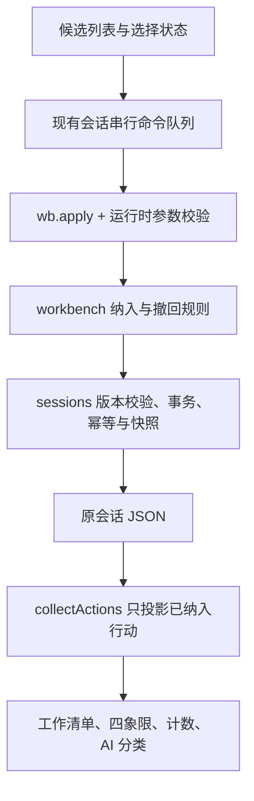

# 工作台执行策略人工筛选与待办推送改造计划

日期：2026-10-24  
状态：已实施（2026-10-24 完成第 10 节六个阶段：协议与迁移、领域规则、清单投影、交互与队列、语义配套、回归与文档）。  
依据：当前工作区实际代码及用户提供的行动页截图；实施以工作区未提交改造为基线，未覆盖或回退既有修改。

## 1. 分析结论

建议采用“生成候选策略 → 人工勾选 → 加入待办 → 执行与复盘”。AI 可以提出多个备选动作，只有用户明确选择的动作才代表执行承诺。减少模型输出条数可以辅助改善阅读，但不能代替人工筛选。

当前问题不只是卡片太多，而是系统把“生成建议”和“决定执行”合并了。截图中新生成策略直接显示“进行中”，并带完成、放弃和阶段进展控件，进一步强化了已经开始执行的错觉。

推荐在原有 `WbAction` 上增加独立的待办纳入状态，继续使用同一份行动数据。用户所说的“推送”，在本地实现为改变清单纳入状态，不复制到独立任务表，不引入消息队列或第二套任务生命周期。

本次覆盖毛选工作台行动及其在工作清单、四象限、计数、分类和复盘中的表现。阅读法行动、独立手工任务沿用原有入口。暂不做语义去重、智能评分、自动推荐勾选或自动安排日期。

## 2. 已核实的现状与根因

| 位置 | 当前行为 | 改造含义 |
| --- | --- | --- |
| `src/main/modules/workbench/generation.ts` / `wbActions` | 每次最多接收 10 条行动，统一 `status: 'todo'` | 新生成行动应明确初始化为候选 |
| `src/renderer/src/components/workbench/WbActStep.tsx` / `genActions` | 将模型返回行动追加到 `wb.actions` | 保存候选仍然自动完成；加入待办需要另一个显式操作 |
| 同文件 `statusLabel` 和行动卡片 | `todo` 显示“进行中”，所有行动都有执行按钮与阶段记录 | 候选不显示执行操作；已加入的 `todo` 文案改为“待办” |
| `src/shared/actions.ts` / `collectActions` | 对工作台全部 `actions` 直接映射 | 这是自动进入工作清单的直接原因，需统一过滤 |
| `src/renderer/src/features/actions/ActionHub.tsx` | 合并独立行动和会话行动，监听 `sessions-changed` | 复用现有刷新机制，不另建同步链路 |
| `src/main/modules/action-planning/public.ts` / `classifyActions` | 生成前与写回前均通过 `collectActions` 查找行动 | 统一过滤同时保护 AI 分类入口和迟到结果 |
| `src/main/modules/workbench/commands.ts` | `action` 是整对象新增或更新 | 不能仅靠前端 checkbox；必须有主进程控制的纳入意图 |
| `src/main/modules/sessions/data.ts` | 正式会话和历史快照共用 JSON 迁移入口 | 新状态需要版本化迁移与恢复测试 |

现有架构已经具备 `wb.apply`、串行写入、`stateVersion` 乐观锁、`mutationId` 幂等和事务回滚能力，应直接复用。

## 3. 目标交互

### 3.1 候选策略区

- 保留 7 / 30 / 90 天分组，标题改为“候选策略”；提示“先筛选本轮要做的事，勾选后加入待办”。
- 每条候选显示 checkbox、动作摘要、目的和验证标准；详细说明可展开，默认不展示阶段记录。
- 默认全部不选。勾选只修改当前页面内的临时选择，关闭页面后不恢复勾选。
- 工具栏显示“已选 N 条”“加入待办（N）”“取消选择”；无选择时禁用提交。
- 提供明确标注范围的“选择本组”，仅选该周期内可加入的候选；不默认全选三个周期。
- 候选支持编辑；未选择的候选持续保留。追加生成不清空旧候选、不自动选择新候选。
- “再补几条行动”改为“补充候选策略”，将人工筛选作为主要下一步。

### 3.2 已加入待办区

- 同一页面另设“已加入待办”，继续按周期展示，保留现有编辑、完成、放弃、恢复、阶段进展功能。
- 成功加入后，将对应行动从候选区移到此区，反馈“已加入 N 条”，并提供“查看工作清单”入口。
- 工作清单和四象限同时可见，来源仍指向原问题，编辑与进度直接修改同一条行动。
- `todo` 显示“待办”，不暗示已经开始执行；不额外扩充 `ActionStatus`。
- 提供“移回候选”及批量整理入口，供用户清理已被自动纳入的历史任务。仅允许未完成、未放弃且没有阶段记录的行动移回，防止隐藏正在执行的记录。
- 移回时保留目的、验证、象限和日期，再次加入时继续沿用；明确提示已有日期会保留。
- 不满足移回条件时显示原因。取消 checkbox 仅取消本次选择，不撤回已经成功加入的行动。

### 3.3 提交行为

一次选择对应一次批量命令、一次事务和一份版本快照。提交期间禁用相关操作。成功后清空本次选择；失败保留有效选择，显示可理解的错误。切换会话清空选择，服务端刷新后剔除已删除或不再符合条件的 ID。

不强制最多只能选几条；可提示先选最重要的 1–3 条，但不能把建议变成用户未要求的硬限制。7 / 30 / 90 天是策略周期，不自动转换为到期日期或象限。

## 4. 数据模型：纳入状态与执行状态分离

建议新增必填字段，示意如下，最终命名在实施时统一：

```ts
type WbActionPlanningState = 'candidate' | 'queued'

interface WbAction {
  // 原有字段保持
  planningState: WbActionPlanningState
  status: 'todo' | 'done' | 'dropped'
}
```

两个字段回答不同问题：`planningState` 表示是否被用户纳入工作清单，`status` 表示执行结果。`queued` 不是消息投递队列，仅代表已纳入。

| 场景 | planningState | status | 工作清单可见性 |
| --- | --- | --- | --- |
| 新生成 / 工作台手工新增 | candidate | todo | 不可见 |
| 人工勾选加入 | queued | todo | 可见 |
| 已完成 | queued | done | 按现有已完成筛选展示 |
| 已放弃 | queued | dropped | 沿用现有隐藏规则 |
| 符合条件后移回候选 | candidate | todo | 不可见 |
| 从工作清单手工创建并关联工作台 | queued | todo | 可见，创建动作本身是明确执行意图 |

候选阶段不允许完成、放弃、写入执行进展。不要用 `dropped` 表示“暂未选中”，不要用空象限表示候选。是否归类与是否加入待办相互独立。

`(sessionId, actionId)` 继续作为聚合身份。重复加入相同 ID 不产生新任务。不同 ID 即便文本相同，也不在本期自动合并，以免误合并不同周期或不同来源的动作。

## 5. 高内聚、低耦合的模块边界



- **workbench 拥有写入规则**：什么行动可以加入、可以撤回，以及候选不能执行的约束集中在工作台领域实现。建议新增 `modules/workbench/action-planning.ts`，由 `commands.ts` 调用，不暴露内部文件给其他模块。
- **shared 只放协议与纯投影**：类型、schema、命令 DTO、只读判定函数，不把权威状态转换放入 shared。
- **sessions 负责持久化机制**：继续执行既有事务、版本和迁移，不反向依赖工作台内部模块。
- **action-planning 消费已选任务**：继续通过已有公共入口分类和编辑，不承担候选审批，不反向调用工作台 UI。
- **renderer 负责交互状态**：选择集合、展开状态、忙碌状态不写入数据库；不能自行把整对象字段改成 `queued` 来代表批准。
- **不新建任务副本**：`standalone_actions` 继续服务独立任务，不用于存放工作台的复制品。

只抽取本功能形成的职责边界，不借机改造所有工作台步骤。

## 6. 命令设计与防绕过

扩展现有 `WorkbenchCommand`：

```ts
| { kind: 'enqueueActions'; ids: string[] }
| { kind: 'returnActionsToCandidates'; ids: string[] }
| { kind: 'createQueuedAction'; value: /* 手工任务创建字段 DTO */ }
```

`createQueuedAction` 专用于工作清单中关联工作台的手工新增；DTO 包含用户输入和稳定 ID，不允许传入 AI 来源、执行进展或任意生命周期状态。主进程建立 `queued + todo` 的完整行动，拒绝覆盖已有 ID。

### 加入待办

1. 运行时校验非空 ID、数组长度（建议上限 200，与批量任务操作规模一致），集合去重。
2. 在当前会话中定位全部 ID；缺失、跨会话或非法状态时整批失败，不静默少加。
3. 仅允许候选 `todo` 纳入；已经 `queued` 的 ID 视为无变化，不重置状态、日期或进度。
4. 只修改 `planningState`，保留 `_context`、周期、KPI、执行标准及其他字段。
5. 由既有会话事务提交；相同 `mutationId` 重试返回原回执，全无变化不重复写快照。

### 移回候选

只接受 `queued + todo + progress.length === 0`。已是候选的 ID 可视为无变化；缺失或不符合规则的整批拒绝。保留全部规划字段，通过版本快照记录本次整理。

### 防止旧通道绕过

- 现有 `action` 命令新增记录只能创建候选；修改现有记录不能改变 `planningState`。
- 仅检查 `validateWorkbenchSession` 的最终状态不足以允许例外又阻止绕过；命令 reducer 必须逐条校验对应意图，最终验证器补充数据不变量检查。
- `workbenchCommands(before, after)` 不能把纳入字段变化折叠为普通 `action` 更新；遇到这种变化应报错，要求走显式命令。
- `newAction` 的工作台分支改为构建 `createQueuedAction`；独立任务与阅读任务分支保持各自逻辑。
- `actionCommands` 编辑已纳入任务时保留新字段；主进程禁止候选被普通更新写入完成状态或阶段进展。
- 不增加单独 SQLite 写入通道；不新增 `actions.push` IPC 通道。既有 `wb.apply` 可以承载新增意图。

## 7. 前端与聚合接入

给 `useSessionMutations` 增加与 `applyReading` 对称的 `applyWorkbench(commands, opts)`，复用同一个 `enqueue`。经 `WorkbenchPage` 传递有限的命令提交能力给行动步骤，不创建第二条保存队列。

建议新增：

| 文件 | 单一职责 |
| --- | --- |
| `src/renderer/src/features/workbench-actions/useActionSelection.ts` | 会话内临时选择、选择范围、失效 ID 清理 |
| `src/renderer/src/components/workbench/WbActionSelectionBar.tsx` | 已选数量、批量加入/取消按钮 |
| `src/renderer/src/components/workbench/WbActionCandidateCard.tsx` | 候选 checkbox、摘要与详情 |

`WbActStep` 保留生成、编辑与复盘编排，组合上述组件；现有复盘事实使用的 `picked` 状态保持独立，新选择状态命名为 `selectedActionIds`，避免混用。

`collectActions` 在工作台分支增加 `planningState === 'queued'` 过滤，成为统一清单入口。工作台页面需要全部候选时直接读取 `wb.actions`，不改变此聚合函数的含义。核查 `ActionsPage` 与 Sidebar 的统计全部来自相同任务集合，不另写一套过滤条件。

成功保存继续使用 `sessions-changed` 刷新；复用现有聚焦刷新和轮询。并发冲突后刷新服务端状态并提示重新核对选择，不自动以最新版本重发旧意图。响应丢失时保留原命令及 `mutationId` 用于原样重试；若现有 hook 未暴露此能力，需要补齐，不把“重试”变成新请求。

## 8. AI 上下文、检查与复盘

这些属于本次必要的配套调整，否则候选仍会被 AI 当成正在执行的工作。

- `generation.ts` 固定填入 `planningState: 'candidate'`，不接受模型决定纳入状态；更新生成结果运行时校验。
- `prompts.ts` 的 `actionsBlock` 区分“候选策略”和“已加入待办”，复盘只把后者作为执行承诺，候选可以作为备选参考。
- `ruleChecksActions` 目前混合检查字段完整性、周期覆盖和 7 天行动数量。拆出“候选内容质量”与“执行组合集中度”的只读检查，避免候选多就被判定多线作战。
- 7 天执行条数以 `queued + todo` 为统计集合；完成和放弃项不占当前执行额度。数量建议是提示，不额外设硬门槛。
- 候选池仍可检查 7 / 30 / 90 天覆盖，但用户只选择 7 天动作不构成加入失败。AI 检查需同样区分建议覆盖与实际执行组合。
- `context.ts` 的动作生成与复盘指纹目前包含整个 `wb.actions`。首期保留这种保守校验：生成期间加入/撤回导致旧结果被拒绝时，给出明确重试提示；不为本功能随意放宽来源有效性。
- 已接受行动纳入待办时保留其原始 `_context`，不冒充重新生成；补测既有来源校验对该变更的兼容性。
- 复核 `wbStepDone`、聊天上下文和版本差异展示，避免把候选数量当成执行成果；差异标签补充“待办纳入状态”。

## 9. 历史数据与恢复策略

推荐兼容优先：旧行动全部迁移为 `queued`，保留正在做、已完成、已放弃和已有阶段记录的状态。不能仅凭 `status: todo` 推断一条旧行动是否从未被用户执行。

这意味着升级不会自动清掉已经积累的待办。首次进入时提示“历史行动已保留，可将尚未开始的行动移回候选”；用户通过本次提供的批量整理入口主动减少旧清单。新生成的策略从升级后开始默认进入候选。

实施要点：

1. 将会话 JSON `SESSION_DATA_VERSION` 从当前 2 升到 3，在 `sessions/data.ts` 添加 2 → 3 迁移；同时修正逐版本推进变量，确保旧 0 / 1 版本能连续迁移到 3。
2. 旧版工作台行动补齐 `planningState: 'queued'`，随后执行严格 schema 校验；新版记录缺字段直接报错，不以运行时 `undefined` 猜测状态。
3. 正式会话与历史快照使用相同解码器；恢复旧快照后行动为已纳入，这是旧版本原有行为。恢复新快照则恢复其中的真实纳入状态。
4. 更新新建行动工厂、测试夹具、演示与 smoke 脚本。空工作台本身无行动，但新建会话版本号必须为 3。
5. 无需增加 SQLite 表或提高数据库 `PRAGMA user_version`；会话 JSON 与数据库结构版本独立。
6. 版本恢复是整个会话状态恢复，可能恢复此前已撤回的任务；沿用既有恢复流程并在说明中明确此效果。
7. 回退应用版本不能直接读取新 JSON；发布前在隔离测试库验证升级，并备份正式数据。旧版本回退应使用升级前备份，不能强行删除字段降级写入。

## 10. 分阶段代码改造清单

| 阶段 | 文件 / 模块 | 交付内容与完成条件 |
| --- | --- | --- |
| 1：协议与迁移 | `shared/types.ts`、`contracts/state-schema.ts`、`contracts/workbench.ts`、`contracts/ipc.ts`、`sessions/data.ts` | 类型、状态 schema、命令 schema 和版本迁移一致；旧会话/快照可读，新数据缺字段拒绝 |
| 2：领域规则 | 新增 `workbench/action-planning.ts`，修改 `commands.ts`、`validation.ts`、`generation.ts` | 批量纳入/撤回与手工创建有明确意图；普通命令不能绕过；生成仅产候选 |
| 3：清单投影 | `shared/actions.ts`、`action-planning/public.ts` 及相关测试 | 候选不进入任务列表、计数或分类；已选行动继续共用原数据 |
| 4：交互与队列 | `useSessionMutations.ts`、`WorkbenchPage.tsx`、`workbench/types.ts`、`WbActStep.tsx`、新增选择组件和样式 | 默认不选、批量加入、反馈、失败重试、历史整理完整可用 |
| 5：语义配套 | `shared/workbench.ts`、`workbench/prompts.ts`、`context.ts`、`renderer/src/lib/diff.ts` | 检查、复盘和历史展示区分候选与执行承诺 |
| 6：回归与文档 | tests、`scripts/smoke-multibook.mjs`、相关示例脚本、`ARCHITECTURE.md`、`docs/four-quadrant-workflow.md` | 完成隔离环境端到端验证，并更新真实行为说明 |

阶段之间可独立提交，但必须整体完成后发布，不能只发布筛选 UI 或只发布聚合过滤。

## 11. 测试与验收

### 自动化测试

- 扩展 `tests/actions.test.ts`：混合候选/已纳入聚合；跨会话相同 ID；阅读、独立、归档和回收站规则；编辑不丢纳入字段；工作清单创建工作台任务直接可见。
- 新增 `tests/workbench-action-selection.test.ts`：批量纳入、重复 ID、空列表、超限、缺失 ID、原子失败、重复提交无变化、撤回限制；普通 `action` 无法改变纳入状态或覆盖已有任务。
- 扩展 `tests/sessions.test.ts`：0/1/2 → 3 连续迁移，旧快照恢复、新快照候选恢复、未知未来版本拒绝、同 mutationId 回执、旧 stateVersion 冲突、事务失败无部分状态和快照。
- 扩展 `tests/contracts.test.ts`：严格字段校验、非法枚举、新命令载荷，以及新版字段缺失拒绝。
- 扩展 `tests/action-classification.test.ts`：候选不调用模型；分类等待期间被移回候选的行动不被迟到结果写回。
- 工作台生成/复盘测试：模型不能自动纳入；来源上下文保留；纳入期间旧 AI 结果按既有规则失效；候选数量不触发执行过量判断。

### Electron/UI 验收场景

1. 模拟生成 8 条策略，候选区显示 8 条，工作清单与侧栏计数不增加。
2. 跨周期勾选 2 条，加入后只增加这 2 条，刷新、离开再返回及重启均保持结果。
3. 双击提交、响应丢失后原请求重试均无重复；提交中的按钮不可重复操作。
4. 在清单编辑、完成、记录进展后，工作台对应同一条行动正确变化。
5. 旧会话升级后任务和阶段记录保留；主动批量移回未开始的任务后，工作清单计数相应下降。
6. 有阶段记录、已完成或已放弃的行动不能移回候选；一个批次含无效项时全部不修改。
7. 切换会话不会串选；执行失败保留选择并显示原因；并发冲突要求重新核对，不覆盖另一入口修改。
8. 候选不能执行完成/进展操作；加入不自动设置日期、不自动分类；AI 分类只处理清单内符合原有条件的任务。
9. checkbox 有可访问名称、键盘可操作；长策略可阅读；窗口变窄时批量操作栏仍可见且不遮挡内容。

实施后已运行 `npm run verify`（架构边界检查、18 个测试文件 107 项回归、主进程与前端两套类型检查、生产构建）并通过。`scripts/smoke-multibook.mjs` 已扩展覆盖“生成候选 → 选择本组 → 加入待办”，真实 Electron smoke 在隔离 userData、SQLite 与模拟模型下通过全部断言；本次实施所在沙箱禁止 Chromium 启动进程沙箱，验证时使用一次性等价脚本附加 `--no-sandbox --disable-gpu` 运行同一套断言，仓库内脚本未加这些参数。不直接操作正式用户数据库。

## 12. 交付标准

用户能明确区分“可以考虑做什么”和“本轮决定做什么”；AI 生成不会自行增加待办。筛选后，工作清单、四象限、统计和复盘使用一致的已纳入集合，任务编辑与进度始终只有一个数据来源。旧任务不丢失，用户能够主动整理历史积累。

## 13. 实施结果（2026-10-24）

六个阶段全部落地，未新增 IPC 通道、SQLite 表或数据库结构版本，也未引入第二套任务生命周期。

新增：

- `src/main/modules/workbench/action-planning.ts`：批量纳入、移回候选、工作清单手工创建与普通命令防绕过的唯一领域入口；`commands.ts` 只负责把命令路由进来。
- `src/renderer/src/features/workbench-actions/useActionSelection.ts`：页面内临时选择，不落库、切换会话清空、服务端刷新后剔除失效 ID。
- `src/renderer/src/components/workbench/WbActionSelectionBar.tsx`、`WbActionCandidateCard.tsx`：粘性批量操作栏与候选卡（勾选、摘要、可展开详情、编辑）。

主要修改：

- 协议与迁移：`shared/types.ts` 增加 `WbActionPlanningState`；`contracts/state-schema.ts` 将 `planningState` 设为必填并新增 `queuedActionInputSchema`；`contracts/workbench.ts` 增加 `enqueueActions` / `returnActionsToCandidates` / `createQueuedAction` 与“纳入状态不能被差异折叠”的保护；`contracts/ipc.ts` 补齐三个命令的运行时 schema；`sessions/data.ts` 把 `SESSION_DATA_VERSION` 升到 3，修正逐版本变量并让 0→1→2→3 连续迁移，旧行动一律迁移为 `queued`。
- 领域规则：`workbench/commands.ts` 命令 reducer 与 `workbench/validation.ts` 的数据不变量拒绝候选执行；`workbench/generation.ts` 只产候选；`shared/actions.ts` 的 `collectActions` 只投影已纳入行动、`newAction` 的工作台分支改用 `createQueuedAction`。
- 交互与幂等：`WbActStep.tsx` 拆成“候选策略 / 已加入待办”，一次提交对应一个命令、一个 `mutationId` 与一份版本快照；失败保留选择并可原样重试，版本冲突刷新服务端状态后要求重新核对；`WorkbenchPage.tsx` 传递 `applyWorkbench` / `reloadSession`；`useSessionMutations.ts` 支持显式 `mutationId`；`wb34.css` 增加筛选区与窄屏样式。
- 语义配套：`workbench/prompts.ts` 区分“候选策略”与“执行承诺”；`shared/workbench.ts` 拆出候选池覆盖、内容质量、执行组合集中度三类只读检查，7 天执行额度只统计 `queued + todo`；`wbStepDone` 只认已纳入的完成行动；`renderer/src/lib/diff.ts` 增加“待办纳入状态”等版本差异标签。

验证：

- 自动化：新增 `tests/workbench-action-selection.test.ts`（10 项），扩展 `actions.test.ts`、`sessions.test.ts`、`contracts.test.ts`、`action-classification.test.ts`；共 18 个测试文件 107 项，`npm run verify` 通过。
- 真实 Electron smoke：模拟模型按 7/30/90 各生成 1 条策略后，全部保持候选且工作清单计数不变；点击“选择本组”后只把该组 1 条加入待办，状态为待办、无阶段进展，页面无错误。
- 未做（计划范围外）：语义去重、智能评分、自动推荐勾选、自动安排日期或象限。
