# 毛选实用工具箱

> 带着问题读，读完就能用。

一个装在电脑上的桌面应用，把《毛泽东选集》里的方法变成解决现实问题的工具。它不讲历史、不背语录，只做一件事：**把你手里那个头疼的问题，按毛选的方法一步步拆开，落到明天能干的事上。**

应用里有两种用法：

- **阅读法**：带着问题去读原文，自己悟出方法，再用到自己身上。适合想真正读懂毛选的人。
- **毛选工作台**：不读全文，直接用毛选的分析框架给一件事做诊断、定路线、排行动。适合手上有件急事要拿主意的人。

两种模式互不干扰，新建问题时二选一。

本文用同一个虚构案例把两种模式各走一遍。

---

## 案例：35 岁被裁的周明

周明 35 岁，在互联网大厂做了 8 年电商产品经理，月薪 3.2 万。今年 8 月底，部门用 AI 工具合并岗位，他被裁了，拿到 13 万赔偿。

- 失业 6 周，投了 120 份简历，8 次面试，0 个 offer。8 次里有 5 次挂在“没有 AI 产品经验”。
- 房贷每月 9800，还剩 22 年；女儿 5 岁；家里每月支出约 2.1 万。妻子做会计，月薪 1.1 万。
- 赔偿加存款共 18 万。
- 报了一个 9800 元的 AI 产品经理课，一直没开始上。
- 亲戚拉他投 30 万合伙开奶茶店，要他 10 月底前答复。
- 每天刷招聘软件到凌晨，还不敢告诉父母。

他的问题是：**继续找产品经理、转 AI，还是跟亲戚开店？**

---

## 一、阅读法：带着问题读原文

阅读法分四步，来自毛选的读书方法：**明确问题 → 聚焦核心 → 联系自身 → 反复应用**。

### 第一步：明确问题

把问题、背景、试过什么写下来，AI 先做诊断：病根在哪、处在什么阶段、该读哪几篇。

周明得到的诊断：

> **主要矛盾**：不是路太少没得选，而是你手里三条路全是没验证过的判断——投简历、AI 课、开店，没有一条拿出过实际动作的结果。
>
> **阶段**：相持期。在原有方向上反复冲锋、冲不动又没换打法；新方向一个动作都没落地。

推荐阅读《实践论》《矛盾论》《论持久战》，每篇都说明了为什么推荐，引用的是他自己的原话。

### 第二步：聚焦核心

打开推荐的文章，AI 带着一个“聚焦问题”帮你在原文里标出关键段落，并说明每段和你的关系。引文逐字核对过原文，对不上的会标“未核对”。

读的时候随手写感悟，每条感悟都挂在对应的段落上。

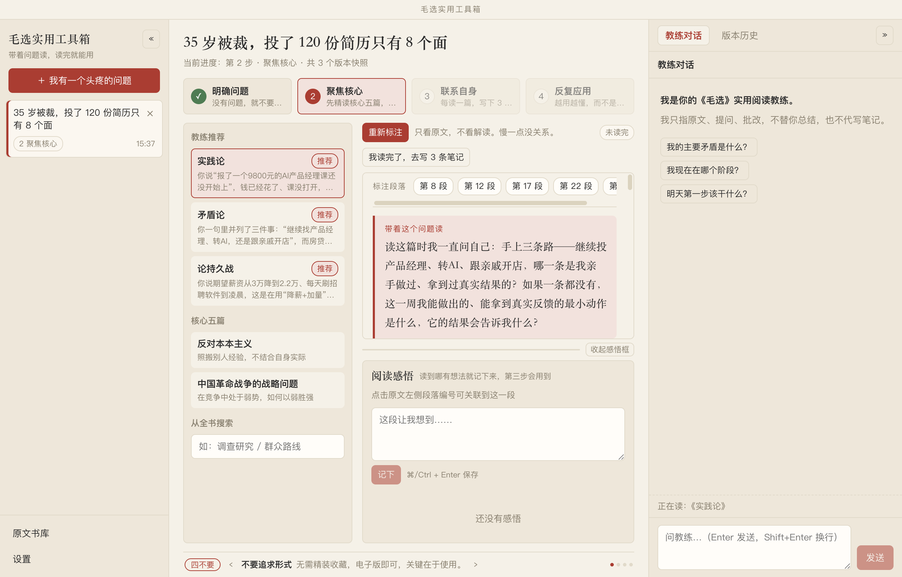

周明在《实践论》里被标出的一段：

> 你要知道梨子的滋味，你就得变革梨子，亲口吃一吃。

AI 的说明：“这段对应你那个 9800 元买了没打开的 AI 课，和亲戚要你 10 月底前投 30 万的奶茶店——两样你都还没亲口吃一口，就已经在比较哪个味道好。”

### 第三步：联系自身

写 3 条笔记：**这篇的核心方法是什么、它对应我哪件事、我接下来做什么**。AI 按评分标准批改，三项都达到 3 分才算过。

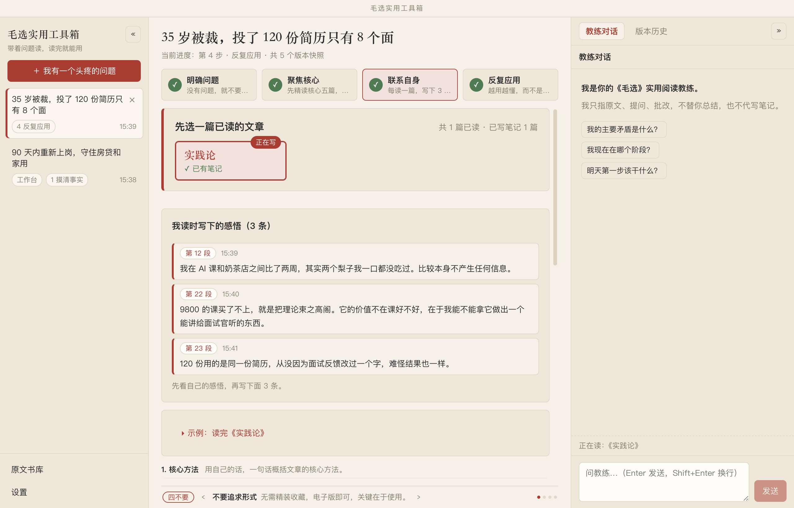

周明的第 3 条笔记得了 4 分，批改意见一针见血：

> 三件大事塞进同一周，每件都做不深；“对比回复率”在本周五之前根本收不到足够样本，你的验证周期和截止日对不上。

AI 只批改、不代写。笔记必须是你自己写的。

### 第四步：反复应用

笔记里的行动变成行动清单，有截止日期，可以分阶段记进展。遇到新情况就回来复盘，AI 会判断该重读哪篇。最后生成“心法三问”：主要矛盾是什么、在哪个阶段、第一步做什么。

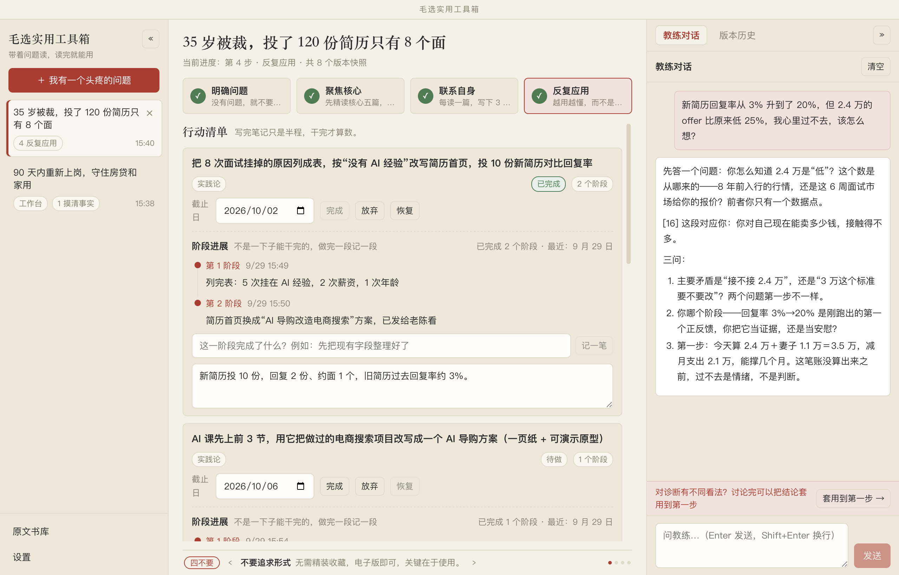

周明改了简历后，回复率从 3% 升到了 20%，又拿到一个 2.4 万的口头 offer。他问教练“比原来低 25%，心里过不去”，教练反问：

> 你怎么知道 2.4 万是“低”？这个数是从哪来的——8 年前入行的行情，还是这 6 周面试市场给你的报价？
>
> 今天算 2.4 万 + 妻子 1.1 万 = 3.5 万，减月支出 2.1 万，能撑几个月。这笔账没算出来之前，过不去是情绪，不是判断。

---

## 二、毛选工作台：给一件事做完整诊断

工作台同样四步：**摸清事实 → 三路诊断 → 综合决策 → 行动复盘**。它不要求你读原文，但每一步都能一键打开对应的原文依据。

### 第一步：摸清事实

> 没有调查，没有发言权。——《反对本本主义》

填一张表：目标、时间尺度（7 天到 5 年）、所处阶段、最卡的 3 个问题、背景、已知事实、谁反对、谁支持、谁在摇摆。

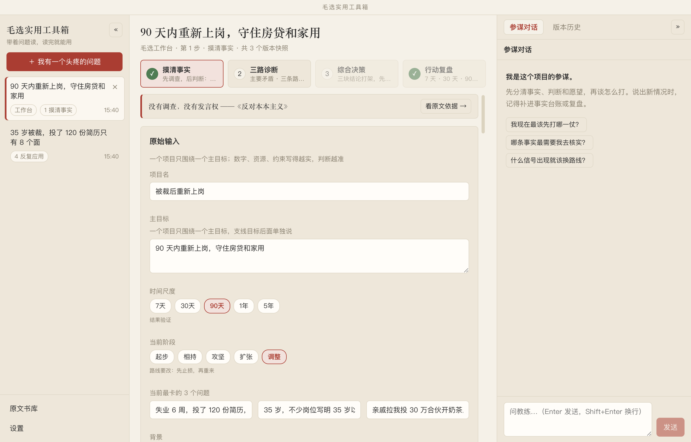

AI 把这些整理成**事实台账**，每一条分成“事实 / 判断 / 愿望”，编上 F1、F2… 的编号。信息不够就追问，不替你脑补。

周明第一次得到 23 条，AI 追问了 5 个问题，比如“18 万现金里，有多少可以动用于学习或投资，而不影响还房贷？”“老陈的内推具体是什么岗位、什么时候能推？”。回答后台账变成 29 条，**原来的编号一个不变**，后面所有分析都引用这些编号，可以逐条回查。

### 第二步：三路诊断

三个分析各干各的，只看事实台账，互不参考：

- **抓主要矛盾**（《矛盾论》）：找出牵一发动全身的那个矛盾。
- **三条路线**（《论持久战》）：稳扎稳打线、主动突破线、保守防御线，各自写明战略判断、方针、可能结果。
- **主客分析**（《中国的红色政权为什么能够存在？》）：客观看趋势、资源、约束，主观看判断、组织执行，每项 1 到 5 分。

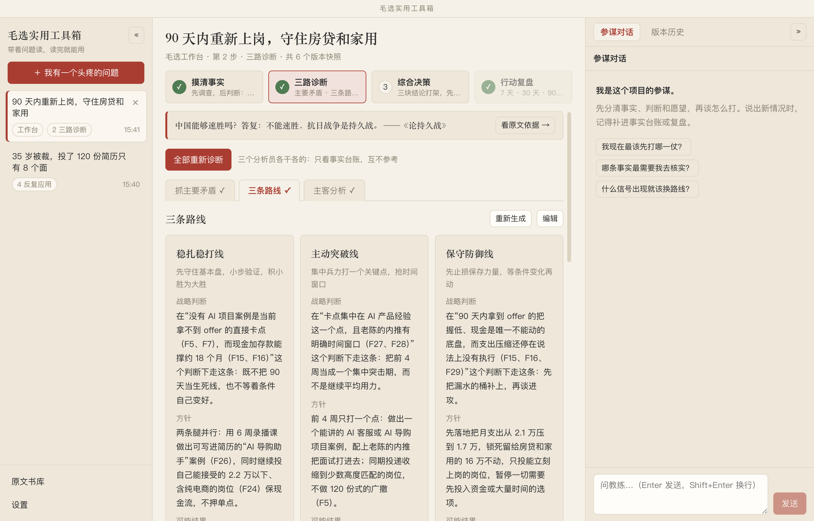

周明的主要矛盾：**目标岗位要求 AI 产品经验，与他缺少能写进简历、讲给面试官听的 AI 项目案例之间的矛盾。**

主客分析给了 12/25 分，最大缺口在“组织执行”：课没开始，内推要的案例没做，支出压缩没执行，每天刷招聘到凌晨——“不是没有方向，而是关键动作没有变成有时限的产出”。

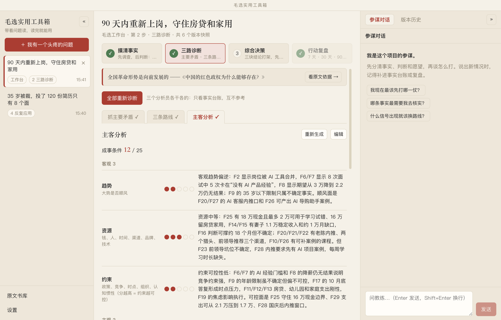

点「看原文依据」，右侧抽屉直接打开原文，高亮对应段落：

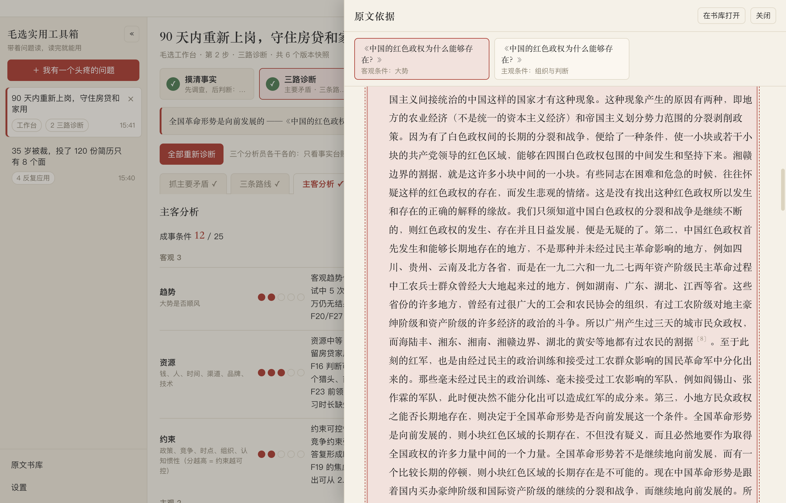

### 第三步：综合决策

把三个分析合成一份决策：主要矛盾、推荐路线、什么时候换线、最大缺口、先打哪一仗、暂时不做什么。

然后过两道检查：

1. **21 条硬规则**：由程序检查，比如引用的事实编号是否存在、路线是否写了切换条件、有没有空话。
2. **AI 红队**：另起一个 AI 专门挑刺。

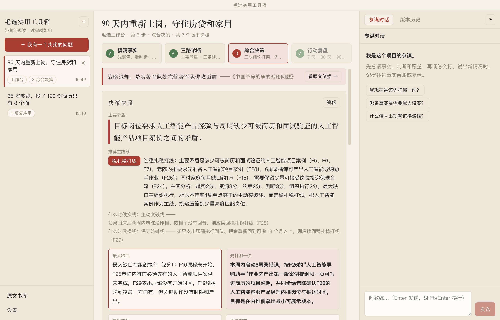

周明的第一版决策被红队挑出 6 个问题，其中一条是算错了账：

> 保守防御线写“支出压到 1.7 万可把可撑时间从 18 个月拉长到 24 个月上下”，与台账口径对不上：按 F15、F29 推算结果明显大于 24 个月。

点「按检查意见修复」，AI 会逐条修改，并留下修复记录，例如：“按 18 万 ÷ 月缺口 0.6 万 ≈ 30 个月改成条件区间”。修完仍有意见的，你可以选择「已知晓，保留」，决定权在你。

最终先打的一仗：**本周启动 6 周录播课，按“AI 导购助手”作业先产出第一版案例提纲和一页项目说明，同步给老陈确认内推岗位和时间。**

### 第四步：行动复盘

> 实践、认识、再实践、再认识。——《实践论》

生成 7 天、30 天、90 天三档行动。每条都写明目的、怎么验证、对应哪条毛选执行标准（如“集中兵力”“不打无准备之仗”），以及和目标的关系。

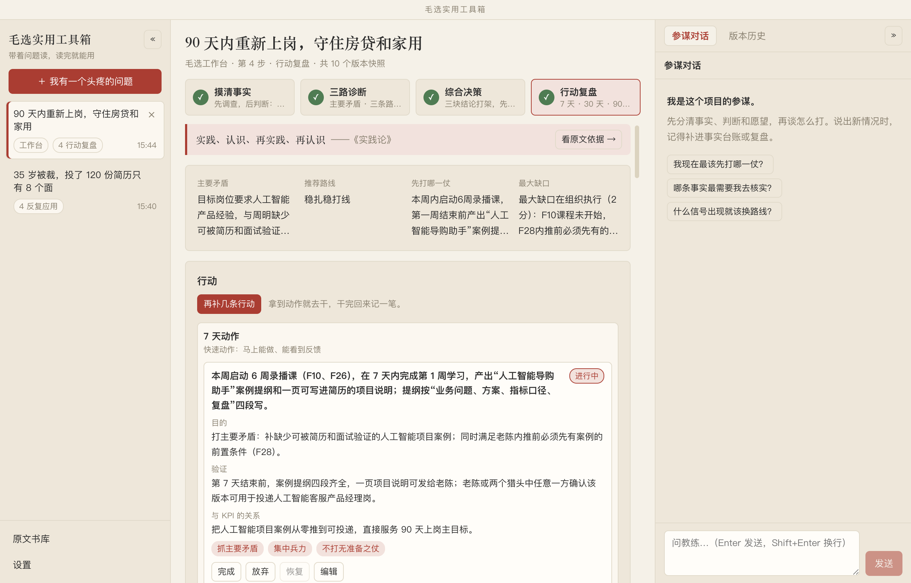

做了一段时间后回来复盘，填三栏：发生了什么、新的事实、判断哪里变了。周明两周后的复盘：

> 按新方法投了 30 份，拿到 4 个面试；老陈内推的公司二面过了，给了 2.4 万的口头意向。奶茶店那条街 500 米内已经有 6 家，跟亲戚说了不投。原来以为输在年龄，其实主要输在“讲不出 AI 项目”。

AI 判断：年龄降为次要矛盾，眼下的卡点变成“口头意向能否转成书面 offer”，**建议回到第二步重新诊断**。建议的新事实可以一键加进台账。

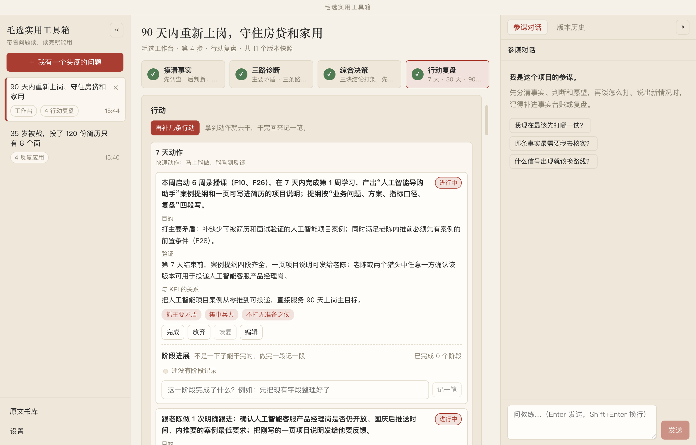

复盘结论只往**项目台账**里追加，不改旧记录。什么时候、因为什么、判断怎么变的，全都留着。

---

## 三、两种模式怎么选

| | 阅读法 | 毛选工作台 |
|---|---|---|
| 适合 | 想读懂毛选、学会方法 | 有件事要拿主意 |
| 要读原文吗 | 要，精读 1 到 3 篇 | 不用，需要时看原文依据 |
| 你要写什么 | 感悟、3 条笔记、行动结果 | 一张表、追问回答、复盘 |
| 得到什么 | 自己悟出的方法和行动清单 | 事实台账、诊断、决策、7/30/90 天行动 |
| 右侧对话 | 教练：只指原文、提问、批改 | 参谋：先分事实，再谈怎么打 |

同一件事也可以两种都做：先用工作台理清局面，再用阅读法把最关键的那篇读透。

---

## 四、贯穿始终的规矩

- **不替你总结，不代写笔记。** AI 只指原文、提问、批改。
- **引用原文一字不差。** 所有引文都和原文核对，对不上就标出来。
- **分清事实、判断、愿望。** 工作台里每个结论都要能追到事实编号。
- **不用毛泽东的口吻说话。** AI 不扮演任何人。
- **结论写成条件式。** “如果……则……”，不打包票。

---

## 五、其他功能

- **版本历史**：每个关键动作都存一个快照，可以对比、恢复。恢复会新增一个版本，旧历史不删。周明的两个项目分别存了 8 个和 11 个版本。
- **原文书库**：《毛选》全文可检索，核心五篇置顶。
- **回收站与归档**：关掉一个问题时可以选归档或移入回收站，回收站 30 天后彻底删除，期间随时恢复。

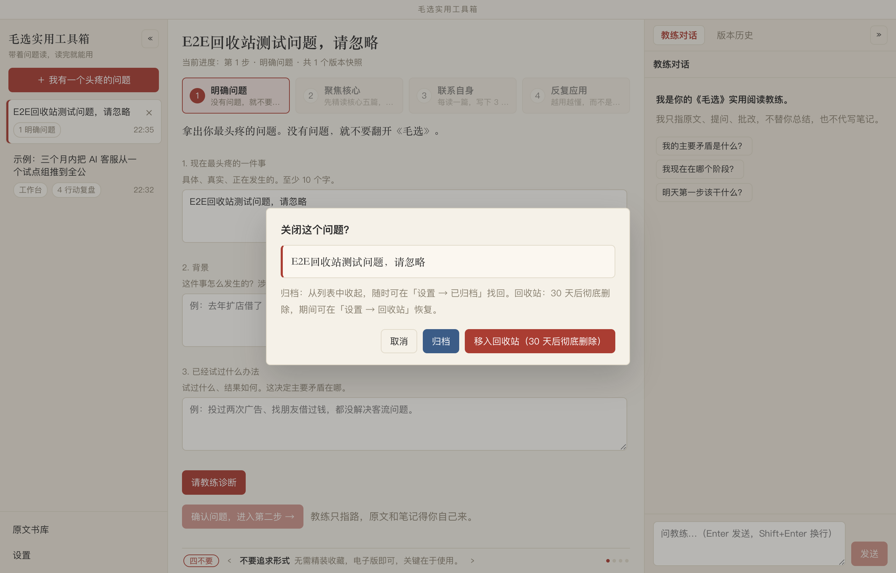

- **数据只存在本机**：所有问题、笔记、对话都存在电脑上的 SQLite 数据库里。AI 调用使用你自己在设置里填的 DeepSeek API Key。

---

## 六、安装与运行

建议使用 Node.js 22。

```bash
cd maoxuan-app
npm install
npm run dev
```

第一次打开后，在「设置」里填入 DeepSeek API Key 并点「测试连接」。

版本说明：`main` 分支（标签 `v0.2`）只有阅读法；`feature/workbench` 分支加入了毛选工作台。
